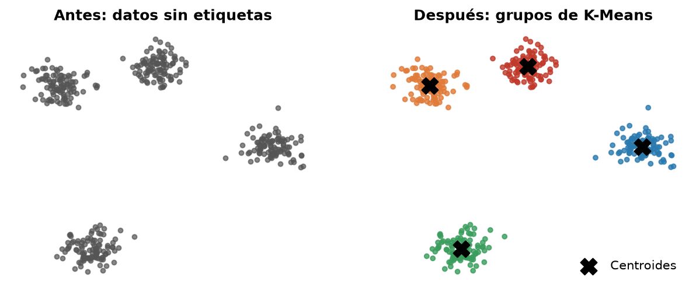
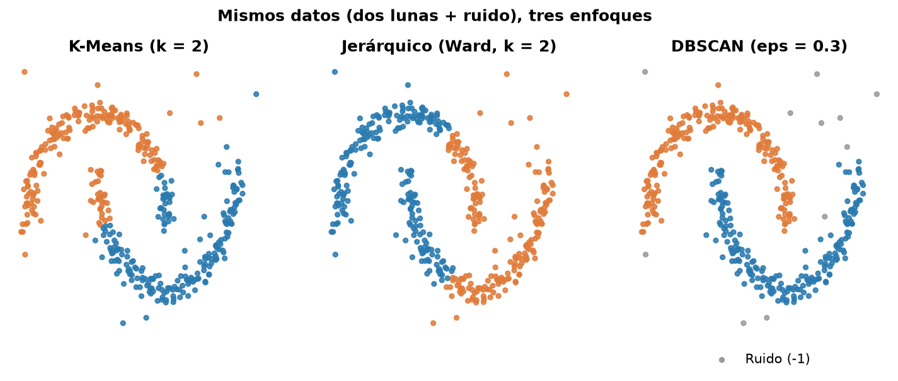
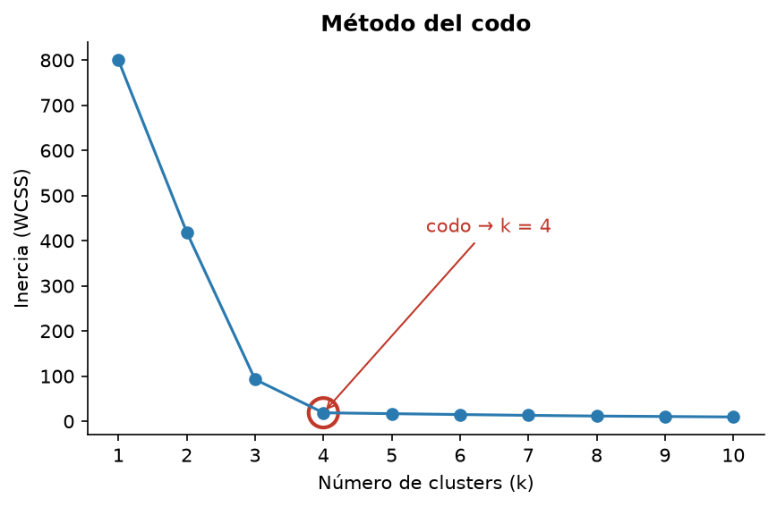
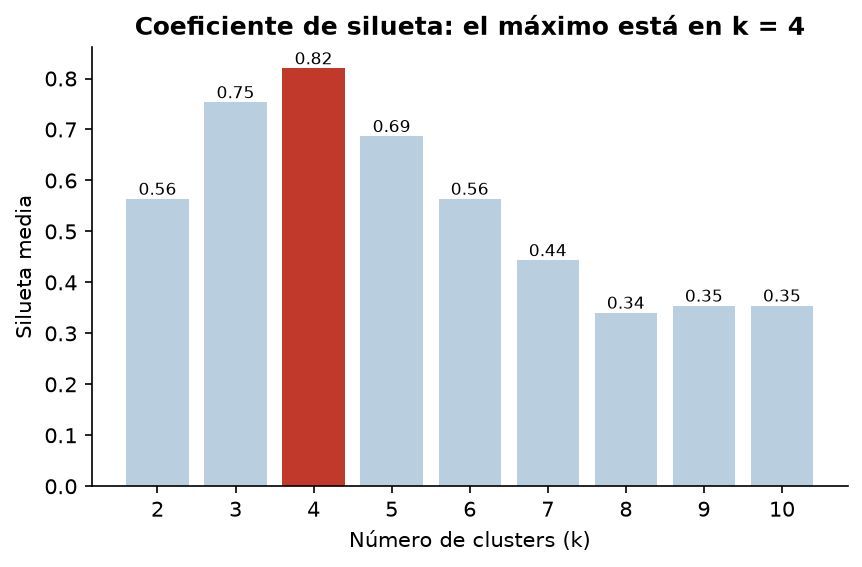
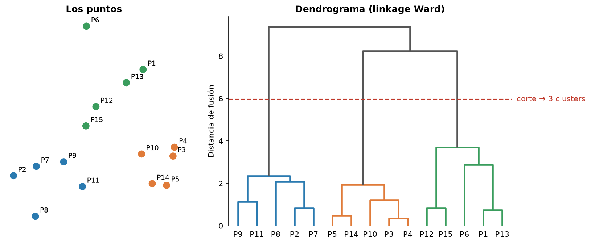
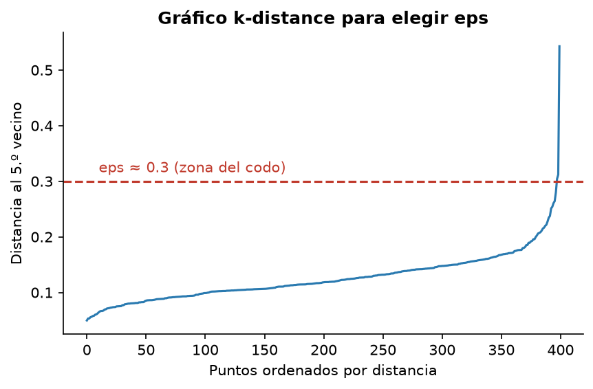
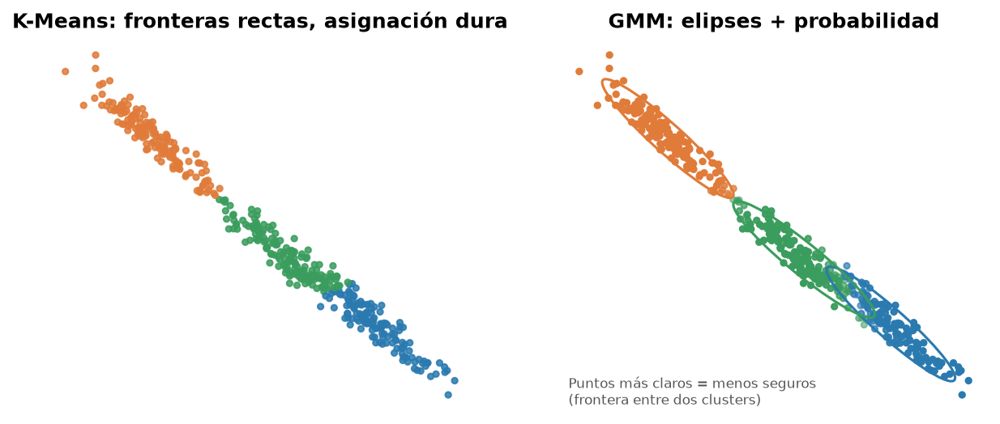

# Investigación: Algoritmos de Clustering

**Autora:** Esra Kesken · Bootcamp de Inteligencia Artificial – Factoría F5

Este documento recoge una investigación sobre los **algoritmos de clustering**
(aprendizaje no supervisado): qué son, sus principales enfoques, cómo evaluar sus
resultados y cuándo usar cada uno. Incluye ejemplos aplicados a Barcelona y un caso
real de un proyecto propio.

## Índice
1. [Aprendizaje no supervisado y clustering](#1-aprendizaje-no-supervisado-y-clustering)
2. [Clustering basado en centroides vs. jerárquico](#2-clustering-basado-en-centroides-vs-jerárquico)
3. [Clustering basado en densidad (DBSCAN)](#3-clustering-basado-en-densidad-dbscan)
4. [Elección del número de clusters y evaluación](#4-elección-del-número-de-clusters-y-evaluación)
5. [Algoritmos](#5-algoritmos)
   - [5.1 K-Means](#51-k-means)
   - [5.2 Clustering Jerárquico Aglomerativo](#52-clustering-jerárquico-aglomerativo)
   - [5.3 DBSCAN](#53-dbscan)
   - [5.4 Gaussian Mixture Models (GMM)](#54-gaussian-mixture-models-gmm)
6. [Tabla comparativa](#6-tabla-comparativa)
7. [Guía práctica: ¿qué algoritmo elegir?](#7-guía-práctica-qué-algoritmo-elegir)
8. [Fuentes](#8-fuentes)

## 1. Aprendizaje no supervisado y clustering

### 1.1 ¿Qué es el aprendizaje no supervisado?
El aprendizaje no supervisado es una rama del machine learning en la que el modelo
trabaja con **datos sin etiquetar**: solo tenemos las variables de entrada (`X`) y no
existe una variable objetivo (`y`). El objetivo no es predecir una respuesta correcta,
sino **descubrir la estructura oculta** de los datos: patrones, grupos o relaciones
que no conocíamos de antemano.

### 1.2 ¿Qué es un algoritmo de clustering?
Un algoritmo de clustering (agrupamiento) es un tipo de algoritmo no supervisado que
divide los datos en **grupos (clusters)**, de forma que los elementos de un mismo grupo
sean muy parecidos entre sí y diferentes a los de otros grupos. Los grupos no se
conocen previamente: el algoritmo los descubre. Además, el modelo no les pone nombre
(solo devuelve "cluster 0", "cluster 1"...); **interpretar qué significa cada grupo
es tarea nuestra**.

*Figura 1. A la izquierda, los datos tal como llegan: sin etiquetas. A la derecha, los cuatro grupos que descubre K-Means; la X marca el centroide de cada uno.*

### 1.3 Diferencias con el aprendizaje supervisado

|                 | Supervisado                          | No supervisado                          |
|-----------------|--------------------------------------|-----------------------------------------|
| Etiquetas (`y`) | Sí                                   | No                                      |
| Objetivo        | Predecir (clasificación o regresión) | Descubrir estructura o grupos           |
| Evaluación      | Métricas claras (accuracy, RMSE...)  | Más difícil: métricas internas (silueta, inercia...) |
| Ejemplo         | Predecir si un piso en Barcelona es caro o barato | Agrupar clientes según su comportamiento |

En resumen: en el aprendizaje supervisado el modelo aprende con "las respuestas
correctas"; en el no supervisado tiene que encontrar el orden por sí mismo.

### 1.4 Propósito
El clustering se usa principalmente para:

- **Exploración de datos:** entender qué grupos naturales existen en un conjunto de
  datos. *Ej.: agrupar los anuncios de Airbnb en Barcelona y descubrir tipos como
  "piso turístico de lujo", "habitación para estudiantes" o "piso familiar".*
- **Segmentación:** tratar de forma distinta a cada grupo. *Ej.: una tienda divide a
  sus clientes en segmentos y envía una campaña diferente a cada uno.*
- **Detección de anomalías:** los puntos que no encajan en ningún grupo pueden ser
  casos raros. *Ej.: una transacción bancaria muy diferente a las habituales puede
  indicar fraude.*

## 2. Clustering basado en centroides vs. jerárquico

### 2.1 Clustering basado en centroides (particional)
Este enfoque divide los datos en un número **k de grupos fijado de antemano**. Cada
grupo está representado por un **centroide** (el punto medio del grupo) y cada dato se
asigna al centroide más cercano. El algoritmo va recolocando los centroides y
reasignando los puntos hasta que los grupos dejan de cambiar.

El resultado es una **partición plana**: cada punto pertenece a un único grupo.

**Algoritmo representativo:** K-Means.

### 2.2 Clustering jerárquico
Este enfoque no divide los datos de una sola vez, sino que construye una **jerarquía
de grupos anidados** que se representa con un árbol llamado **dendrograma**. Existen
dos estrategias:

- **Aglomerativa (de abajo arriba):** cada punto empieza siendo su propio grupo y, en
  cada paso, se unen los dos grupos más parecidos, hasta que todo queda en un solo grupo.
- **Divisiva (de arriba abajo):** se parte de un único grupo con todos los datos y se
  va dividiendo.

No es necesario fijar k al principio: se elige después, "cortando" el dendrograma a
la altura deseada.

**Algoritmo representativo:** Clustering Jerárquico Aglomerativo.

### 2.3 Diferencias principales

|                        | Basado en centroides            | Jerárquico                              |
|------------------------|---------------------------------|-----------------------------------------|
| Número de clusters (k) | Hay que fijarlo antes           | Se elige después cortando el dendrograma |
| Resultado              | Partición plana                 | Grupos anidados (árbol)                 |
| Escalabilidad          | Rápido, funciona con muchos datos | Lento y costoso con muchos datos      |
| Interpretabilidad      | Centroides fáciles de interpretar | El dendrograma muestra cómo se forman los grupos |
| Forma de los clusters  | Tiende a grupos esféricos       | Depende del tipo de enlace (*linkage*)  |

## 3. Clustering basado en densidad (DBSCAN)

### 3.1 ¿En qué consiste?
El clustering basado en densidad parte de una idea sencilla: **un cluster es una zona
donde los puntos están muy juntos (alta densidad)**, separada de otras zonas por
regiones con pocos puntos. Los puntos aislados, que no pertenecen a ninguna zona
densa, se consideran **ruido**.

El algoritmo más conocido es **DBSCAN** (*Density-Based Spatial Clustering of
Applications with Noise*), que utiliza dos hiperparámetros:

- **`eps` (ε):** el radio del vecindario alrededor de cada punto, es decir, qué
  distancia consideramos "cerca".
- **`min_samples`:** el número mínimo de puntos que debe haber dentro de ese radio
  para que una zona se considere densa.

Con estos dos valores, DBSCAN clasifica cada punto en uno de tres tipos:

| Tipo de punto | Descripción |
|---------------|-------------|
| **Núcleo (core)** | Tiene al menos `min_samples` vecinos dentro de su radio `eps` |
| **Frontera (border)** | No es núcleo, pero está dentro del radio de un punto núcleo |
| **Ruido (noise)** | No es núcleo ni frontera; se etiqueta como `-1` |

**Funcionamiento:** el algoritmo elige un punto núcleo y crea un cluster con todos sus
vecinos. Si alguno de esos vecinos también es núcleo, el cluster se sigue
**expandiendo** a través de él. Cuando ya no se puede expandir más, busca otro punto
núcleo no visitado y empieza un nuevo cluster. Los puntos que no se alcanzan desde
ningún núcleo quedan como ruido.

*Ejemplo:* si miramos desde un dron la playa de la Barceloneta en verano, veremos
grupos de personas muy juntas (clusters) con formas distintas, y algunas personas
caminando solas (ruido). Nadie nos dice cuántos grupos hay: aparecen solos por la
densidad.

### 3.2 Diferencias con el clustering basado en centroides y el jerárquico

|                        | Centroides (K-Means)    | Jerárquico                      | Densidad (DBSCAN)              |
|------------------------|-------------------------|---------------------------------|--------------------------------|
| ¿Hay que fijar k?      | Sí                      | No (se corta el dendrograma)    | **No**, los clusters surgen de la densidad |
| Forma de los clusters  | Esférica                | Depende del *linkage*           | **Cualquier forma** (alargada, curva, anillos...) |
| Outliers               | Los asigna siempre a un grupo | Los asigna siempre a un grupo | **Los detecta como ruido** |
| Parámetros clave       | k                       | Tipo de enlace y altura de corte | `eps` y `min_samples`         |
| Punto débil            | Hay que conocer k; sensible a outliers | Lento con muchos datos | Difícil elegir `eps`; falla si los clusters tienen densidades muy distintas |

En resumen: K-Means busca **centros**, el jerárquico construye un **árbol de
similitudes** y DBSCAN busca **zonas densas**. Por eso DBSCAN es especialmente útil
cuando los grupos tienen formas irregulares o cuando hay mucho ruido en los datos.

*Figura 2. Con dos grupos en forma de luna, K-Means y el jerárquico (Ward) cortan los datos con una línea y mezclan las lunas. DBSCAN sigue la densidad: separa bien las dos lunas y marca los puntos aislados como ruido (gris).*

### 3.3 Ejemplo de aplicación: detección de fraude
Imaginemos que analizamos las transacciones con tarjeta de crédito en Barcelona para
detectar fraude. En este caso **DBSCAN es más adecuado que K-Means** por dos motivos:

1. **No sabemos cuántos tipos de gasto "normal" existen**, así que no podemos fijar k.
   DBSCAN encuentra los grupos automáticamente a partir de la densidad.
2. **Las transacciones fraudulentas suelen ser diferentes a todas las demás.** K-Means
   las metería a la fuerza en algún grupo, mientras que DBSCAN las marca directamente
   como **ruido (`-1`)**, lo que nos da una lista de transacciones sospechosas para
   revisar.

## 4. Elección del número de clusters y evaluación

### 4.1 ¿Por qué es importante elegir bien k y los hiperparámetros?
En el aprendizaje no supervisado no tenemos etiquetas, así que **no podemos calcular
métricas como el accuracy**. Sin embargo, el algoritmo siempre devuelve un resultado,
aunque no tenga sentido. Por eso la elección de los hiperparámetros es clave:

- **Si k es demasiado pequeño**, grupos realmente distintos se fusionan en uno solo y
  perdemos información.
- **Si k es demasiado grande**, un grupo real se divide en subgrupos artificiales que
  no tienen significado.
- **En DBSCAN**, un `eps` demasiado pequeño hace que casi todos los puntos sean ruido,
  y uno demasiado grande une todo en un único cluster.

Para tomar esta decisión se utilizan **métricas internas**, que evalúan la calidad
del agrupamiento usando solo los propios datos.

### 4.2 Método del codo (Elbow method)
Se basa en la **inercia** (o WCSS, *Within-Cluster Sum of Squares*): la suma de las
distancias al cuadrado de cada punto a su centroide. Cuanto menor es la inercia, más
compactos son los grupos.

**Procedimiento:**
1. Ejecutar K-Means para distintos valores de k (por ejemplo, de 1 a 10).
2. Calcular la inercia para cada k.
3. Representar k (eje X) frente a la inercia (eje Y).
4. Elegir el punto donde la curva forma un **"codo"**, es decir, donde la inercia deja
   de bajar rápidamente.

La inercia siempre disminuye al aumentar k (con tantos clusters como puntos sería 0),
por eso no buscamos el mínimo, sino el punto a partir del cual **añadir más clusters
ya no aporta una mejora significativa**.

*Figura 3. La inercia baja mucho hasta k = 4 y después casi no cambia: el codo indica k = 4.*

- **Ventaja:** sencillo y visual.
- **Desventaja:** a veces el codo no es claro y la elección es subjetiva.

### 4.3 Coeficiente de silueta (Silhouette score)
Mide lo bien que encaja cada punto en su cluster comparado con el cluster vecino más
cercano. Para cada punto *i* se calcula:

- **a(i):** distancia media a los puntos de **su propio cluster** (cohesión).
- **b(i):** distancia media a los puntos del **cluster vecino más cercano** (separación).

$$s(i) = \frac{b(i) - a(i)}{\max(a(i),\ b(i))}$$

| Valor | Interpretación |
|-------|----------------|
| Cercano a **+1** | El punto está bien agrupado y lejos de otros clusters |
| Cercano a **0** | El punto está en la frontera entre dos clusters |
| **Negativo** | El punto probablemente está en el cluster equivocado |

Se calcula la media de todos los puntos para varios valores de k y se elige el k con
la **silueta media más alta**.

*Figura 4. Con los mismos datos de la figura 3, la silueta media es máxima en k = 4, lo que confirma el resultado del codo.*

- **Ventaja:** da un valor numérico objetivo y tiene en cuenta tanto la cohesión como
  la separación.
- **Desventaja:** es costoso con muchos datos y puede dar valores engañosos con
  clusters de formas irregulares.

### 4.4 Otros métodos
- **Índice de Davies-Bouldin:** mide la similitud entre cada cluster y su más
  parecido. **Cuanto menor, mejor.**
- **Índice de Calinski-Harabasz:** relación entre la dispersión entre clusters y
  dentro de ellos. **Cuanto mayor, mejor.**
- **BIC / AIC:** se usan en los Gaussian Mixture Models para elegir el número de
  componentes. **Cuanto menor, mejor.**
- **Dendrograma:** en el clustering jerárquico, se corta donde aparece el salto
  vertical más grande.
- **Gráfico k-distance:** en DBSCAN, ayuda a elegir `eps` buscando también un "codo".

En la práctica, lo recomendable es **combinar varios métodos** y, sobre todo,
comprobar que los grupos obtenidos **tienen sentido para el problema real**.

## 5. Algoritmos

### 5.1 K-Means

**Mecanismo**

K-Means divide los datos en **k clusters**, cada uno representado por su centroide.
Funciona de forma iterativa:

1. **Inicialización:** se colocan k centroides iniciales.
2. **Asignación:** cada punto se asigna al centroide más cercano (normalmente con
   distancia euclidiana).
3. **Actualización:** cada centroide se mueve a la **media** de los puntos de su
   cluster (de ahí el nombre *means*).
4. **Repetición:** se repiten los pasos 2 y 3 hasta que los centroides dejan de
   moverse (**convergencia**).

El objetivo es minimizar la **inercia** (suma de distancias al cuadrado de cada
punto a su centroide). Para evitar una mala inicialización se usa **K-Means++**, que
elige centroides iniciales alejados entre sí (es la opción por defecto en
scikit-learn).

**Ventajas**
- Sencillo de entender e implementar.
- Muy rápido y escalable a grandes volúmenes de datos.
- Los centroides facilitan la interpretación de cada grupo.

**Desventajas**
- Hay que fijar k de antemano.
- Supone clusters **esféricos** y de tamaño parecido; falla con formas irregulares.
- Sensible a los **outliers**, que desplazan los centroides.
- El resultado depende de la inicialización.
- Requiere **escalar** las variables, porque se basa en distancias.

*Ejemplo de sensibilidad a outliers:* si en un cluster hay cinco adolescentes que usan
el móvil 3, 4, 4, 5 y **20** horas al día, el centroide (la media) pasa de **4 h** a
**7,2 h** por culpa de un solo valor extremo. Ese centroide ya no representa a nadie
del grupo y, en la siguiente iteración, algunos puntos pueden asignarse al cluster
equivocado. Alternativas: eliminar outliers antes, usar **K-Medoids** (el centro es un
punto real) o **DBSCAN**, que marcaría ese valor como ruido.

**Casos de uso comunes**
- Segmentación de clientes en marketing.
- Compresión de imágenes (reducir los colores a k colores principales).
- Agrupación de documentos o productos similares.

**Aplicación propia: adicción al móvil en adolescentes**

En mi proyecto final del curso de Data Analytics de IT Academy (Barcelona Activa)
utilicé K-Means sobre un dataset de **3.000 adolescentes** (Kaggle, datos
sintéticos). El análisis general mostraba que la mayoría tenía un nivel de adicción
alto, pero quería entender **cómo afecta esa adicción a sus vidas de forma
distinta**.

- **Variables:** horas de uso diario, sueño, redes sociales, videojuegos, tiempo de
  estudio, rendimiento académico, autoestima, ansiedad, depresión y control parental.
- **Preprocesamiento:** escalado con `StandardScaler`.
- **Elección de k:** método del codo (WCSS para k = 1–10), que indicó **k = 3**.

| Cluster | Perfil | Uso diario | Rend. académico | Ansiedad | Depresión | Control parental |
|---------|--------|-----------|-----------------|----------|-----------|------------------|
| 0 · Riesgo bajo | **Resilient Adolescents** (adolescentes resilientes) | 5,0 h | 73,8 | 2,7 | 5,1 | 0,50 |
| 1 · Riesgo medio | **High-Functioning Anxious Adolescents** (alto rendimiento, ansiosos) | 4,2 h | 81,0 | 7,7 | 4,5 | 0,43 |
| 2 · Riesgo alto | **Vulnerable Adolescents** (adolescentes vulnerables) | 5,9 h | 69,6 | 6,9 | 6,9 | 0,61 |

- **Cluster 0 – Resilientes:** rendimiento académico moderado, control parental
  equilibrado y ansiedad baja. Mantienen la estabilidad emocional a pesar del uso
  digital elevado. *Apoyo:* programas de alfabetización digital y hábitos saludables
  para mantener el equilibrio.
- **Cluster 1 – Alto rendimiento, ansiosos:** el mejor rendimiento académico y más
  uso educativo, pero menos control parental y ansiedad alta. Son ambiciosos y
  orientados al logro, pero están emocionalmente tensionados. *Apoyo:* gestión del
  estrés y bienestar digital centrado en la regulación emocional.
- **Cluster 2 – Vulnerables:** el peor rendimiento académico, la depresión más alta y
  el mayor tiempo de uso. Tienen el control parental más alto, pero un bienestar
  emocional bajo. *Apoyo:* mentoría, apoyo emocional, reducir el uso excesivo y
  recuperar la implicación académica.

**Conclusión:** el nivel de adicción era muy similar en los tres grupos (≈ 9/10), pero
el clustering mostró que **su impacto es diferente** en cada perfil. Esto permite
pasar de una conclusión general ("los adolescentes son adictos") a **intervenciones
adaptadas a cada grupo**. Un dato interesante: el grupo con más control parental es
el más vulnerable, lo que sugiere que el control por sí solo no basta.

🔗 [Ver el proyecto](https://github.com/esrakesken/teen-phone-addiction)

### 5.2 Clustering Jerárquico Aglomerativo

**Mecanismo**

Es un método **de abajo arriba** (*bottom-up*) que construye una jerarquía de
clusters:

1. **Inicio:** cada punto es un cluster independiente.
2. **Distancias:** se calcula la distancia entre todos los clusters.
3. **Fusión:** se unen los **dos clusters más cercanos** y se actualizan las distancias.
4. **Repetición:** se repite hasta que todos los puntos forman un único cluster.

Cada fusión queda registrada en un **dendrograma**, un árbol en el que la altura de
cada unión indica lo diferentes que eran los grupos. Para obtener el número final de
clusters se **corta el dendrograma** a una altura determinada; una buena práctica es
cortar donde aparece el salto vertical más grande.

*Figura 5. A la izquierda, 15 puntos; a la derecha, su dendrograma. Abajo se unen primero los puntos más cercanos (P3 y P4, P1 y P13...) y, cuanto más arriba, más distintos son los grupos que se fusionan. Las ramas más largas cruzan la línea roja: cortar ahí da 3 clusters, con los mismos colores que los puntos.*

Un parámetro clave es el **criterio de enlace (*linkage*)**, que define cómo se mide
la distancia entre dos grupos:

| Linkage | Distancia entre grupos | Efecto |
|---------|------------------------|--------|
| **Single** | Entre los dos puntos **más cercanos** | Clusters alargados, en cadena |
| **Complete** | Entre los dos puntos **más lejanos** | Clusters compactos |
| **Average** | **Media** de todas las distancias entre pares | Intermedio |
| **Ward** | Une los grupos que **menos aumentan la varianza** interna | Clusters equilibrados (opción por defecto en scikit-learn) |

**Ventajas**
- No es necesario fijar k de antemano.
- El dendrograma es muy visual y ayuda a entender la estructura de los datos.
- Es determinista: con los mismos datos siempre da el mismo resultado.
- Según el *linkage*, puede detectar clusters de distintas formas.

**Desventajas**
- **Coste computacional alto**: necesita calcular y guardar todas las distancias, por
  lo que no escala bien a grandes volúmenes de datos.
- Las fusiones son definitivas: un error en un paso no se puede corregir después.
- Sensible al ruido y a los outliers (especialmente con *single linkage*).
- El resultado depende mucho del *linkage* elegido.

**Casos de uso comunes**
- Biología: árboles filogenéticos y análisis de expresión génica.
- Segmentación de clientes en conjuntos de datos pequeños o medianos.
- Organización de documentos en temas y subtemas.
- Análisis de redes sociales y comunidades.

### 5.3 DBSCAN

**Mecanismo**

DBSCAN agrupa los puntos según la **densidad**: un cluster es una zona donde hay
muchos puntos cerca unos de otros. Usa dos hiperparámetros, `eps` (radio del
vecindario) y `min_samples` (mínimo de vecinos para que una zona sea densa), y
clasifica cada punto como **núcleo**, **frontera** o **ruido**. Los clusters crecen
expandiéndose desde los puntos núcleo, y los puntos aislados se etiquetan como ruido
(`-1`). *(El funcionamiento se explica en detalle en la [sección 3](#3-clustering-basado-en-densidad-dbscan).)*

**¿Cómo elegir los hiperparámetros?**
- **`min_samples`:** como regla general, al menos el número de dimensiones + 1; en la
  práctica se suele usar **2 × número de dimensiones**, y un valor mayor si los datos
  tienen mucho ruido.
- **`eps`:** se usa el **gráfico k-distance**: se calcula para cada punto la distancia
  a su k-ésimo vecino más cercano (k = `min_samples`), se ordenan de menor a mayor y
  se elige el valor donde la curva forma un **codo**.

*Figura 6. La mayoría de puntos tiene su 5.º vecino muy cerca; al final la curva sube de golpe (son los puntos aislados). El codo, en torno a 0.3, es un buen valor para `eps`.*

**Ventajas**
- No hay que fijar el número de clusters.
- Detecta clusters de **cualquier forma** (alargados, curvos, en anillo...).
- Identifica automáticamente los **outliers** como ruido.
- Los outliers no distorsionan los clusters (a diferencia de K-Means).

**Desventajas**
- Es muy sensible al valor de `eps`, que puede ser difícil de elegir.
- Funciona mal cuando los clusters tienen **densidades muy diferentes**, porque un
  único `eps` no sirve para todos. (Una variante, **HDBSCAN**, resuelve este problema.)
- Pierde eficacia en datos con **muchas dimensiones**, donde las distancias dejan de
  ser significativas.
- Requiere escalar las variables.

**Casos de uso comunes**
- **Detección de anomalías y fraude** (ver el ejemplo de la sección 3.3).
- **Datos geográficos:** encontrar zonas de alta concentración a partir de
  coordenadas GPS. *Ej.: detectar las zonas de Barcelona donde más se dejan las
  bicicletas de Bicing.*
- Procesamiento de imágenes y segmentación de objetos.
- Detección de fallos en datos de sensores.

### 5.4 Gaussian Mixture Models (GMM)

**Mecanismo**

GMM supone que los datos se generan a partir de una **mezcla de varias distribuciones
normales (gaussianas)**, y que cada una corresponde a un cluster. Cada componente se
define con tres parámetros:

| Parámetro | Significado |
|-----------|-------------|
| **Media (μ)** | Centro del cluster |
| **Covarianza (Σ)** | Forma y orientación del cluster (circular, elíptico, inclinado) |
| **Peso (π)** | Proporción de los datos que pertenece a ese cluster |

Los parámetros se estiman con el algoritmo **EM (Expectation-Maximization)**:

1. **Inicialización:** se colocan k gaussianas (a menudo a partir de K-Means).
2. **Paso E (Expectation):** se calcula, para cada punto, la **probabilidad** de
   pertenecer a cada cluster.
3. **Paso M (Maximization):** se actualizan μ, Σ y π usando esas probabilidades.
4. **Repetición:** hasta que los parámetros dejan de cambiar.

La gran diferencia con K-Means es que GMM hace **clustering suave (*soft
clustering*)**: en lugar de decir "este punto pertenece al cluster 1", dice "este
punto pertenece al cluster 1 con un 70 % de probabilidad y al cluster 2 con un 30 %".
Esto es muy útil para los puntos que están en la frontera entre dos grupos.

*Figura 7. Con grupos alargados e inclinados, K-Means corta con fronteras rectas y asigna mal parte de los puntos cerca de donde se tocan los grupos. GMM ajusta una elipse a cada grupo y, en la zona donde se tocan, los puntos salen más claros porque su probabilidad de pertenencia es menor.*

El número de componentes se suele elegir con los criterios **BIC o AIC** (cuanto
menor, mejor).

**Ventajas**
- Da la **probabilidad** de pertenencia a cada cluster, no solo una etiqueta.
- Gracias a la covarianza, detecta clusters **elípticos, inclinados y de distinto
  tamaño**, no solo esféricos como K-Means.
- Es un modelo probabilístico: permite estimar densidades y generar nuevos datos.
- Ofrece una forma estadística de elegir k (BIC/AIC).

**Desventajas**
- Hay que fijar el número de componentes.
- Supone que los datos siguen distribuciones gaussianas; falla con formas muy
  irregulares (lunas, anillos).
- Más lento y complejo que K-Means.
- Sensible a la inicialización; puede quedarse en un óptimo local.
- Con pocos datos y muchas dimensiones, estimar la covarianza es difícil.

**Casos de uso comunes**
- Segmentación de clientes cuando un cliente puede encajar parcialmente en varios
  perfiles.
- Reconocimiento de voz y de hablantes.
- Visión por computador: separar el fondo de los objetos en un vídeo.
- Finanzas: modelado de riesgo y detección de anomalías (puntos con muy baja
  probabilidad).

## 6. Tabla comparativa

| Criterio | K-Means | Jerárquico aglomerativo | DBSCAN | GMM |
|----------|---------|-------------------------|--------|-----|
| **Enfoque** | Centroides (particional) | Jerárquico | Densidad | Probabilístico (distribuciones) |
| **¿Hay que fijar k?** | Sí | No (se corta el dendrograma) | No | Sí (nº de componentes) |
| **Parámetros clave** | k | *Linkage* y altura de corte | `eps`, `min_samples` | Nº de componentes, tipo de covarianza |
| **Forma de los clusters** | Esférica | Depende del *linkage* | Cualquier forma | Elíptica |
| **Tipo de asignación** | Dura (un solo cluster) | Dura | Dura + ruido | **Suave** (probabilidades) |
| **Outliers** | Muy sensible | Sensible | **Los detecta como ruido** | Sensible (aunque tienen baja probabilidad) |
| **Escalabilidad** | Muy alta | Baja | Media | Media |
| **¿Determinista?** | No (depende de la inicialización) | Sí | Casi (salvo puntos frontera) | No (depende de la inicialización) |
| **Cómo elegir parámetros** | Codo, silueta | Dendrograma, silueta | Gráfico k-distance | BIC / AIC |
| **Ideal para** | Grandes datos con grupos compactos | Datos pequeños y ver la estructura | Formas irregulares y datos con ruido | Grupos solapados y casos frontera |

**Resumen:** no existe un algoritmo mejor en general. La elección depende de la
**forma de los datos**, de si **conocemos k**, de la presencia de **outliers** y del
**tamaño del dataset**. En la práctica es recomendable probar varios algoritmos,
compararlos con métricas como la silueta y, sobre todo, comprobar que los grupos
**tienen sentido para el problema real**.

## 7. Guía práctica: ¿qué algoritmo elegir?

A continuación se recogen algunos escenarios reales y el razonamiento para elegir el
enfoque adecuado.

| Escenario | Elección | Por qué |
|-----------|----------|---------|
| Un gimnasio de Barcelona quiere agrupar a sus socios según edad, frecuencia y horario, sin saber qué grupos existen. | **Aprendizaje no supervisado (clustering)** | No hay variable objetivo (`y`); los grupos se tienen que descubrir. |
| Un colegio agrupa a sus alumnos según notas, faltas y entrega de deberes. | **Clustering para exploración, segmentación y detección de anomalías** | Permite descubrir perfiles, dar apoyo distinto a cada grupo y detectar alumnos que no encajan en ninguno. El modelo no pone nombre a los grupos: los interpretamos nosotros. |
| 1 millón de clientes y sabemos que queremos 5 segmentos. | **K-Means** | Es rápido, escala bien y k ya se conoce. El jerárquico sería demasiado lento. |
| Al probar varios k, la silueta media da 0,45 (k=2), 0,62 (k=3) y 0,38 (k=4). | **k = 3** | Es el valor con la silueta media más alta: grupos más cohesionados y mejor separados. |
| 40 alumnos agrupados por intereses; no sabemos cuántos grupos hay y queremos mostrar el resultado visualmente a la dirección. | **Jerárquico aglomerativo** | No hace falta fijar k, el dendrograma es muy visual y con pocos datos su lentitud no es un problema. |
| Uso de Bicing en zonas muy densas (Eixample) y poco densas (Horta). | **HDBSCAN** en lugar de DBSCAN | Con un único `eps`, uno pequeño convierte Horta en ruido y uno grande une los clusters del Eixample. HDBSCAN se adapta a densidades distintas. |
| Un adolescente está justo en la frontera entre dos perfiles de riesgo y lo va a revisar un psicólogo escolar. | **GMM** | K-Means le asignaría un único grupo; GMM da la probabilidad de pertenecer a cada uno (p. ej., 55 % / 45 %), lo que muestra que es un caso dudoso que merece atención individual. |

## 8. Fuentes

### Documentación oficial
- scikit-learn. *Clustering* (User Guide).
  https://scikit-learn.org/stable/modules/clustering.html
- scikit-learn. *Gaussian mixture models* (User Guide).
  https://scikit-learn.org/stable/modules/mixture.html
- scikit-learn. *silhouette_score* (API Reference).
  https://scikit-learn.org/stable/modules/generated/sklearn.metrics.silhouette_score.html

### Material didáctico
- Google for Developers. *Clustering* (Machine Learning course).
  https://developers.google.com/machine-learning/clustering
- IBM. *¿Qué es el clustering?*
  https://www.ibm.com/es-es/think/topics/clustering
- StatQuest with Josh Starmer (YouTube): vídeos sobre K-Means, clustering jerárquico
  y DBSCAN. https://www.youtube.com/@statquest
- James, G., Witten, D., Hastie, T. y Tibshirani, R. (2021). *An Introduction to
  Statistical Learning* (2.ª ed.), cap. 12: *Unsupervised Learning*. Springer.
  https://www.statlearning.com/

### Artículos de referencia
- Ester, M., Kriegel, H.-P., Sander, J. y Xu, X. (1996). *A density-based algorithm
  for discovering clusters in large spatial databases with noise*. KDD-96.
  *(artículo original de DBSCAN)*
- Rousseeuw, P. J. (1987). *Silhouettes: a graphical aid to the interpretation and
  validation of cluster analysis*. Journal of Computational and Applied Mathematics,
  20, 53–65. *(origen del coeficiente de silueta)*
- Campello, R. J. G. B., Moulavi, D. y Sander, J. (2013). *Density-based clustering
  based on hierarchical density estimates*. PAKDD 2013. *(HDBSCAN)*

### Proyecto propio
- Kesken, E. *Lifestyle Factors on Teen Phone Addiction*, proyecto final de Data
  Analytics, IT Academy (Barcelona Activa).
  https://github.com/esrakesken/teen-phone-addiction
### Figuras
- Todas las figuras de este documento son de elaboración propia, con datos sintéticos
  (`make_blobs`, `make_moons` de scikit-learn). Se pueden regenerar con
  [`scripts/generar_figuras.py`](scripts/generar_figuras.py).
